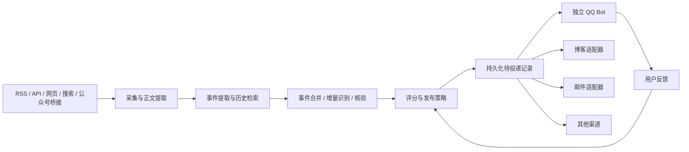

# 系统设计

## 服务边界

AInxiety 负责内容、事件记忆、调度、发布决策和投递记录。QQ Bot 负责平台连接、格式渲染、发送、回执及反馈入口。公众号采集可作为独立服务，将结果转换成 RSS 或标准采集记录。

博客通过 API 接入，不共享数据库。现有博客具备 `POST /api/article`、`PUT /api/article/{id}`，采用 Session 鉴权；后续拟新增受限的机器发布凭据及外部消息 ID 幂等处理，复用文章服务。此入口尚未实现。

邮箱由邮件适配器通过邮件服务 API 或 SMTP 投递，初期可以作为投递 worker 的模块，不必单独部署。保存服务商接收、实际投递（如支持通知）、退信等不同状态；服务商接收不代表进入收件箱。SMTP Message-ID 不作为可靠的收件方去重保证。

## 双模式投递

已确认采用推送优先、拉取补充的方案，分阶段实现：

1. 第一阶段配置订阅，AInxiety 根据内容类型、主题和目标生成投递记录，worker 主动通过 HTTP Webhook 推送。下游持久化接收任务后快速确认，执行完成再回执。
2. 第二阶段支持同一订阅的任务领取接口，供下游离线重启后补投，也支持仅能主动出站的下游以拉取为主。

两种方式共用 Publication、Delivery、幂等键、配额和状态机；一次投递不会因为改用拉取而成为新任务。推送和拉取必须通过同一套原子领取与租约机制，已被接收或结果未知的任务先核对状态，不能直接重新发送。详细配置、接口和恢复流程见 [渠道契约](contracts.md)。

拉取补投只处理已产生且仍有效的待投递记录；历史内容浏览是只读能力，不自动导致对外发布。离线积压按有效期和恢复策略处理，默认不逐条补发过期快讯。跨日恢复时重新按发送当日检查配额，限制补投速率，避免恢复后刷屏。

第一版使用数据库待投递表（Transactional Outbox）和 HTTP，无需引入消息中间件。内容与投递记录事务内落库，网络发送在事务外进行。不同渠道独立重试，不互相阻塞。

## 技术基线

| 职责 | 选型 |
| --- | --- |
| API 与结构校验 | Python、FastAPI、Pydantic |
| 内容处理流程 | LangGraph |
| 采集 | HTTPX、feedparser；正文提取器经样本评测选择 |
| 业务存储与语义检索 | PostgreSQL、pgvector |
| 定时触发 | APScheduler，第一版单调度实例 |
| 持久化执行 | 数据库任务表、独立 worker、租约与重试 |
| 部署 | Docker Compose |

LangGraph 管理内容处理节点与恢复；业务任务表负责触发、执行权和重试，事件表负责长期记忆，投递表负责外部副作用。模型输出必须经过结构校验，不让模型直接修改发布限额或执行渠道发送。

初期不引入多 Agent、独立消息中间件或额外向量数据库。模型提供商、模型名称、embedding 模型与维度、搜索服务商、依赖版本在实现前选定并锁定；更换 embedding 模型需要版本化及重建向量。

## 内容与发布策略

以下数字是建议默认值，可配置：

| 项目 | 默认规则 |
| --- | --- |
| 重点来源采集 | 每 2～5 分钟，服从来源限流与缓存策略 |
| 普通来源采集 | 每 15～30 分钟 |
| 重大快讯 | 有足够来源证据后立即进入投递 |
| 普通快讯 | 每目标渠道每天最多 5 次 |
| 总推送上限 | 每目标渠道每天最多 8 次，包含日报、周报、更新 |
| 日报 | 每天一次，目标 5～8 个事件；不足不凑数 |
| 周报 | 每周一次，概括重点和后续变化 |

上线前必须配置发布时区及日报、周报时间，不能把服务器 UTC 默认值视为用户时区。计数以目标渠道所在发布时区的日期为准。日报和周报当天预留各一次额度，剩余额度保留给重大快讯；总额度耗尽时不自动突破上限，事件进入后续汇总并记录抑制原因。

同一渠道的配额预留与待投递记录创建在事务内完成，防止并发超额。一次报告如必须拆成多个平台消息，应按实际消息数预算，优先压缩成摘要和报告链接。结果未知的投递暂占额度，确定未发送才释放。

重大消息不等待日报；普通候选按相关性、新颖性、影响程度排序。来源可信度、证据完整性作为独立门槛，不能靠热度分数补足。具体评分权重由样本与用户反馈校准。

重点来源可访问且渠道允许主动发送时，争取来源更新后 5～10 分钟内完成投递；这是目标，不是保证。分别记录源发布时间、发现时间、处理完成时间和发送时间，定位延迟来自哪里。

## 事实与证据

- 发布内容采用标题、短摘要、原文链接，必要时附状态说明；默认快讯约 100～200 中文字。
- 重大科研声明区分“作者声称”“提供证据”“获得独立验证”“存在争议”“已撤回”。模型不充当数学证明或科学结论的最终验证者。
- 多篇报道若引用同一公告，只算一个证据源，不把转载数量当成独立验证。
- 每个关键事实绑定来源。无法读取正文时只生成证据范围内的内容，不由标题补全细节。
- 事件时间、文章发布时间、采集时间分别存储；时间不明时保留未知状态。
- 网页文本作为待处理数据，不作为系统指令；来源内容不能触发任意工具调用或改变投递配置。
- 错误内容产生纠正版本；渠道支持编辑则关联原消息更新，否则按配额发送纠正并引用原事件。旧版本保留审计记录。

## 去重与中期记忆

1. 按来源 ID、规范化 URL 和正文哈希识别重复抓取。仅删除已知跟踪参数，保留有语义的查询参数；同一 URL 正文变化需重新处理。
2. 从文章提取主体、动作、产品与版本、时间、关键事实；一篇文章允许关联多个事件。
3. 联合多语言向量检索与实体、版本、关键词检索，召回最近 90 天的相关事件；明确实体匹配时扩展到更早历史。
4. 通过模型判断重复、实质进展、不同事件或信息不足，并保存证据与理由。相似度不能单独决定合并。
5. 发布前比较该渠道已报道的事实，确认增量；生成后再做文案相似度检查。

同主题不等于同事件；新版本、开放下载、价格调整、结论被推翻可能构成新事件或事件新版本。来源增加但事实没变时，补充证据即可。边界不清的条目进入待复核，不直接丢弃。

支持人工合并与拆分事件，保留原 ID 的映射和审计信息。事件合并及待投递生成需要事务或锁，避免同时采集的重复报道各自生成快讯。

| 数据 | 建议保留策略 |
| --- | --- |
| 原始正文与抓取快照 | 90 天后可归档或删除 |
| 事件、关键事实、证据链接 | 长期保留 |
| 发布记录、反馈、纠正历史 | 长期保留 |
| 高频语义检索范围 | 最近 90 天，按需检索历史 |

## 日报、周报与反馈

日报从事件库选取当天重要事件，已发快讯可以作为简短回顾；周报从事件及版本变化生成，避免机械拼接日报。两类报告均保留每个条目的来源链接，并检查撤回与纠正状态。

报告以本地日期或周区间生成稳定 ID，定时任务重跑不会重复建文。记录报告覆盖的事件版本，后续修订可追溯。

反馈类型：有用、太水、重复、主题增加、主题减少、事实错误。反馈先关联具体事件或报告条目，再调整可撤回的偏好权重。事实纠错和重复反馈进入专门处理流程，不只改变推荐分数。
